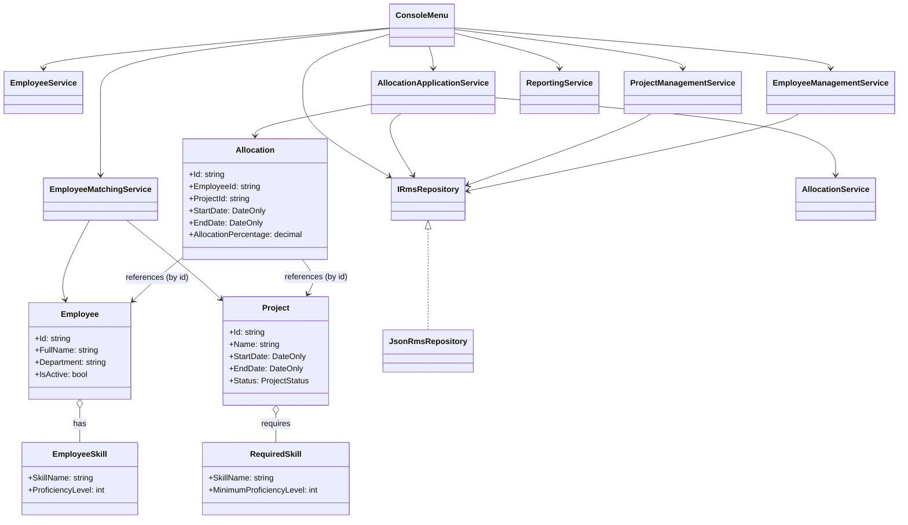

# TechNova RMS — Design Overview

This document describes the structure and key design decisions of the TechNova Resource Management System (`TechNova.RMS`). It is based on the actual source files in the repository and is written for students, reviewers, or interviewers.

## 1. Purpose

`TechNova.RMS` is a small, console-based Resource Management System implemented on .NET 10. Its primary goals are:

- Manage employees and projects.
- Allocate and release employees to projects.
- Match employees to projects by skill and availability.
- Produce simple reports (bench report, project staffing, department utilisation).
- Persist data to JSON files for easy inspection and local use.

This solution is intended for learning and demos rather than production deployment.

## 2. Architecture

The code is organized into four focused projects:

- `TechNova.RMS.Domain` (Domain)
  - Contains core models and domain rules:
    - `Employee`, `EmployeeSkill`, `EmploymentType` (enum).
    - `Project`, `ProjectRequiredSkill`, `ProjectStatus` (enum).
    - `Allocation` and `AllocationService` (validation logic).
  - Responsibilities: business invariants and domain behaviour.

- `TechNova.RMS.Application` (Application / Use Cases)
  - Implements application services that orchestrate use cases and interact with persistence:
    - `IRmsRepository` (persistence abstraction).
    - `EmployeeService`, `EmployeeMatchingService`, `EmployeeManagementService`, `ProjectManagementService`, `AllocationApplicationService`, `ReportingService`.
  - Responsibilities: use-case coordination and input validation where appropriate.

- `TechNova.RMS.Infrastructure` (Infrastructure)
  - Provides concrete infrastructure implementations:
    - `JsonRmsRepository` implements `IRmsRepository` using `System.Text.Json` and files on disk.
  - Responsibilities: serialization, file I/O, and DTO mapping.

- `TechNova.RMS.Console` (Presentation / Console UI)
  - Console application and interactive UI:
    - `Program.cs` — composition root (DI setup).
    - `ConsoleMenu` — menu-driven text UI.
  - Contains sample data files under `TechNova.RMS.Console/Data` (`employees.json`, `projects.json`, `allocations.json`).

## 3. Dependency Direction

Verified project references and direction:

- `TechNova.RMS.Domain` has no outward references.
- `TechNova.RMS.Application` depends on `TechNova.RMS.Domain` and declares `IRmsRepository`.
- `TechNova.RMS.Infrastructure` depends on `TechNova.RMS.Application` and `TechNova.RMS.Domain` and implements `JsonRmsRepository`.
- `TechNova.RMS.Console` depends on `TechNova.RMS.Application`, `TechNova.RMS.Infrastructure`, and `TechNova.RMS.Domain`.

Directional summary:

Domain <- Application <- Console

Domain <- Infrastructure (implements Application's persistence abstraction)

## 4. Main Workflows

High-level workflows implemented by the application services and driven by `ConsoleMenu`:

- Employee management
  - Add: `EmployeeManagementService.AddEmployee(Employee)` checks duplicates and calls `IRmsRepository.SaveEmployees`.
  - Update: `EmployeeManagementService.UpdateEmployee(...)` updates domain state via `Employee.UpdateDetails` and saves.
  - Deactivate: `EmployeeManagementService.DeactivateEmployee(string)` sets `Employee.IsActive = false` and saves.
  - List: `EmployeeService.GetEmployeeSummaries()` reads employees and returns formatted lines for the UI.

- Project management
  - Create: `ProjectManagementService.AddProject(Project)` verifies duplicate IDs and persists.
  - Update: `Project.UpdateDetails(...)` and `Project.ChangeStatus(...)` enforce project invariants.

- Allocation and release
  - Allocate: `AllocationApplicationService.Allocate(Allocation)` finds the employee and project, delegates to `AllocationService.ValidateAllocation`, appends the allocation, and calls `IRmsRepository.SaveAllocations`.
  - Release: `AllocationApplicationService.Release(string allocationId)` removes the allocation and persists.
  - Notification: allocation and release actions write a `Console.WriteLine` message (simulated notification).

- Employee matching
  - `EmployeeMatchingService.FindMatchingEmployees(project, employees, allocations)` filters active employees that match required skills and have availability across project dates.

- Reporting
  - `ReportingService` provides:
    - Bench report by date and threshold.
    - Project staffing summary (employee count, total allocation).
    - Department utilisation (active employee counts and utilisation percentage).

## 5. Persistence

- `IRmsRepository` (`TechNova.RMS.Application.Persistence.IRmsRepository`) defines methods to read and write lists of domain objects (employees, projects, allocations).

- `JsonRmsRepository` (`TechNova.RMS.Infrastructure.Persistence.JsonRmsRepository`):
  - Implements `IRmsRepository`.
  - Uses `System.Text.Json` with `JsonStringEnumConverter` and writes indented JSON.
  - Maps between DTO classes (`EmployeeData`, `SkillData`, `ProjectData`, `RequiredSkillData`, `AllocationData`) and domain types.
  - Runtime data directory (code): `Path.GetFullPath(Path.Combine(AppContext.BaseDirectory, "..\\..\\..\\Data"))`.
    - Source sample files are located at `TechNova.RMS.Console/Data` in the repository.
  - File names: `employees.json`, `projects.json`, `allocations.json`.

Note: the runtime `Data` directory is calculated relative to the assembly base path. Depending on how the app is launched, the resolved path may differ; this document reports the code's logic, not runtime verification.

## 6. Dependency Injection

- `Program.cs` (in `TechNova.RMS.Console`) is the composition root.
  - Service registrations observed (all singletons):
    - `services.AddSingleton<IRmsRepository, JsonRmsRepository>();`
    - `services.AddSingleton<EmployeeMatchingService>();`
    - `services.AddSingleton<ReportingService>();`
    - `services.AddSingleton<EmployeeService>();`
    - `services.AddSingleton<AllocationService>();`
    - `services.AddSingleton<AllocationApplicationService>();`
    - `services.AddSingleton<EmployeeManagementService>();`
    - `services.AddSingleton<ProjectManagementService>();`
    - `services.AddSingleton<ConsoleMenu>();`
  - The provider is built and `ConsoleMenu` is resolved and run: `menu.Run()`.

- The application relies on constructor injection for `ConsoleMenu` and services. Application services depend on `IRmsRepository` or other services as constructor parameters (observed in source code).

## 7. Class Diagram (Mermaid)

Below is a simplified class diagram focused on the main types and their relationships. Aliases are used to keep the diagram readable. The relationships reflect the code (implementation, composition, and uses).

## 8. SOLID Principles (plain language + one concrete example)

Each principle is explained briefly with a single concrete example from the code.

- SRP — Single Responsibility Principle
  - Plain: A class should have one reason to change.
  - Example: `TechNova.RMS.Domain.Employees.Employee` maintains employee state (identity, contact, designation, department, cost rate, skills, active flag) and enforces employee-related rules (valid IDs, non-empty name/email, skill-level constraints). It centralizes employee data and validation.

- OCP — Open/Closed Principle
  - Plain: Code should be open to extension but closed to modification.
  - Example (partial): Domain classes expose behaviour through methods (e.g., `AddSkill`) so callers don't mutate internals. However, application services are concrete types and `Program.cs` must be edited to change registrations. This means OCP is only partially achieved.

- LSP — Liskov Substitution Principle
  - Plain: Implementations should behave as callers expect so they can be substituted without surprises.
  - Example: `JsonRmsRepository` implements `IRmsRepository`. Implementing the interface is necessary but not sufficient: the repository must honour the interface's expected behaviour (for example, return lists when requested, persist and read data correctly, and not introduce unexpected exceptions) so callers depending on `IRmsRepository` can safely substitute implementations.

- ISP — Interface Segregation Principle
  - Plain: Prefer small, specific interfaces over large, general ones.
  - Example (partial): `IRmsRepository` groups read/write methods for employees, projects, and allocations. This is convenient for a small app but could be split into `IEmployeeRepository`, `IProjectRepository`, and `IAllocationRepository` as the system grows.

- DIP — Dependency Inversion Principle
  - Plain: High-level modules depend on abstractions, not concrete implementations.
  - Example: Application services depend on the `IRmsRepository` abstraction. `Program.cs` binds `IRmsRepository` to `JsonRmsRepository` at startup.

Notes: The document avoids claiming any principle is perfectly implemented; where code falls short it is called out.

## 9. Deliberate Design Trade-offs

- Console interface
  - Reason: minimal setup and good for teaching and demos.
  - Limitation: single-user, interactive only; not suitable for concurrent or web scenarios.

- JSON persistence
  - Reason: easy to inspect and edit, no database server required.
  - Limitation: no transactional guarantees, limited concurrency, and poor query performance.

- Simulated notifications
  - Reason: simple demonstration point using `Console.WriteLine` in `AllocationApplicationService`.
  - Limitation: not a real notification system; in production you would use an event bus or notification/messaging service.

---
