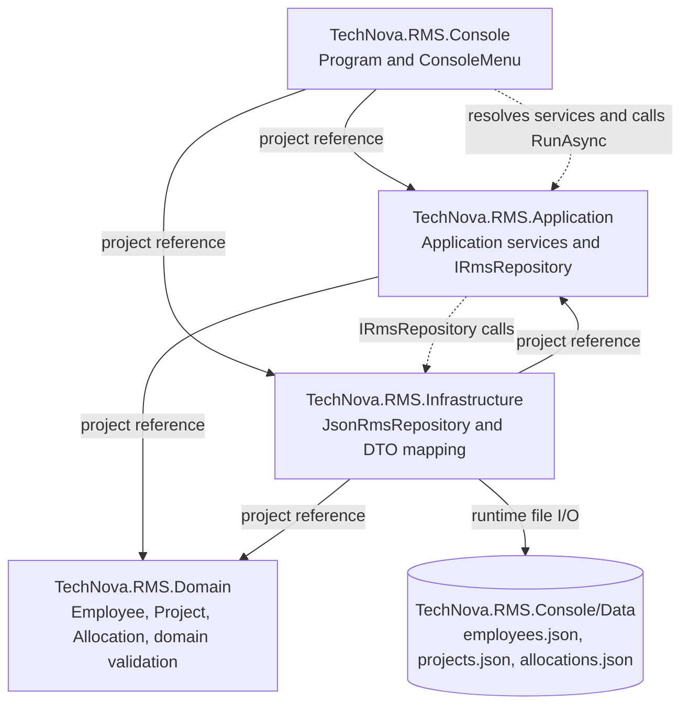

# TechNova RMS Architecture

This diagram reflects the current project references and runtime composition. Solid arrows show compile-time project dependencies; the dashed arrow shows the runtime call from the console UI through the application services to the repository abstraction and JSON implementation.

## Dependency and lifetime notes

- `Program.cs` is the composition root and registers `JsonRmsRepository`, application services, the domain `AllocationService`, and `ConsoleMenu`.
- The application layer owns `IRmsRepository`; Infrastructure implements it.
- All registrations are singleton because this is a single-process console application, the repository owns one in-process `SemaphoreSlim`, and the services are stateless coordinators. A web application would normally use scoped lifetimes and a database-backed repository instead.
- `JsonRmsRepository` resolves its data directory from `AppContext.BaseDirectory`, so it does not depend on the process current working directory.
